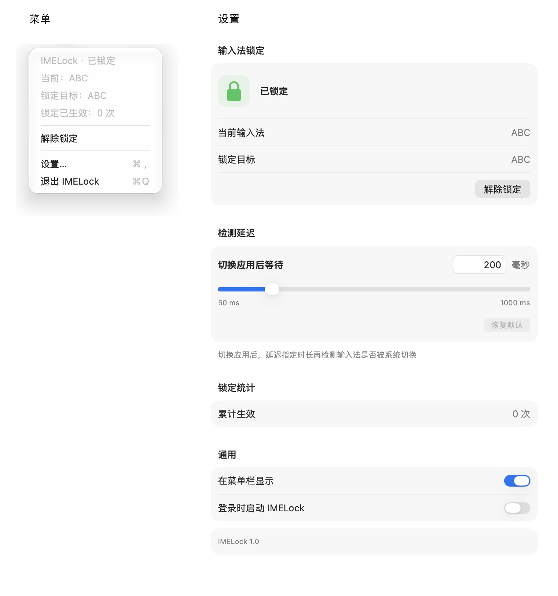

# IMELock

**切换应用后，自动恢复你选定的 macOS 输入法。**

选好输入法并锁定后，IMELock 会在切换到其他应用时自动检查并恢复目标。**同一应用内手动切换输入法后，等到下次切换应用才恢复。**

按应用切换触发，无周期性轮询；无需辅助功能或输入监控权限。

## 系统要求

| 项目 | 运行要求 |
| --- | --- |
| 操作系统 | macOS 14.0（Sonoma）及以上 |
| 处理器 | Apple Silicon（M 系列）或 Intel（x86_64），分别提供安装包 |

兼容性验证范围见[验证记录](docs/VALIDATION.md#当前构建与兼容性)。

## 安装与启动

从 [Releases](https://github.com/scplsy/IMELock/releases/latest) 下载适合处理器的安装包：

| Mac 处理器 | 安装包 |
| --- | --- |
| Apple Silicon（M 系列） | `IMELock-版本号-arm64.dmg` |
| Intel | `IMELock-版本号-x86_64.dmg` |

打开 DMG，将 `IMELock.app` 拖入“应用程序”后启动。当前安装包采用 ad-hoc 签名，未经过 Apple 公证；若 macOS 阻止打开，可参考 [Apple 的打开说明](https://support.apple.com/zh-cn/102445)。

如需从源码构建，先安装完整的 Xcode（已验证的工具链版本见[开发指南](docs/DEVELOPMENT.md#构建)），再在终端执行：

```bash
git clone https://github.com/scplsy/IMELock.git
cd IMELock
bash Scripts/build.sh
open build/IMELock.app
```

构建产物为 `build/IMELock.app`。启动后，点击菜单栏中的键盘图标即可使用，应用不显示 Dock 图标。可在设置中隐藏菜单栏图标；隐藏后，重新打开应用即可进入设置。

如需登录时启动，先将应用放入“应用程序”文件夹并从该位置打开，再到设置中开启。更多构建选项见[开发指南](docs/DEVELOPMENT.md#构建)。

## 使用方法

1. 通过 macOS 输入法菜单或快捷键，切换到想使用的输入法。
2. 点击 IMELock 菜单栏图标，选择 **锁定当前输入法**。
3. 切换到其他应用后，IMELock 会检查并恢复锁定目标。
4. 更换目标时，先 **解除锁定**，切换输入法，再重新锁定。

| 菜单栏图标 | 状态 |
| --- | --- |
| 键盘 + 开锁角标 | 未锁定，可以自由切换 |
| 键盘 + 锁角标 | 已锁定，切换应用时检查并恢复目标 |
| 键盘 + 暂停角标 | 已暂停，打开菜单查看原因 |

### 菜单与设置

下图展示锁定 ABC 输入法后的菜单和设置界面。



点击菜单中的 **设置…** 可以调整：

- **检测延迟**：切换应用后，延迟指定时长再检测输入法是否被系统切换。默认 200 毫秒，可设为 50–1000 毫秒。滑块按 10 毫秒调整，也支持精确输入；修改自动保存。
- **在菜单栏显示**：默认开启，修改立即生效并保存。隐藏图标后继续锁定输入法，重新打开 IMELock 可进入设置。
- **登录时启动 IMELock**：默认关闭。若 macOS 要求批准，可通过设置页进入系统登录项设置。

**累计生效次数**只统计成功恢复输入源的操作，失败或未实际切换不会增加。次数在重启、解锁和更换目标后保留。

## 常见问题

### 为什么切换输入法后没有立刻恢复？

自动恢复由前台应用切换触发。同一应用内切换输入法、窗口或桌面时，等待下一次切换到其他应用后再检查。启动应用、锁定当前输入法和点击 **重试恢复** 时也会检查一次。

### 为什么微信输入法内部仍然会切换中英文？

IMELock 锁定的是 macOS 的**系统输入源**，第三方输入法内部的中英文模式由输入法自身控制。切换应用后也存在短暂的恢复等待时间，期间输入的字符仍可能使用原输入法。

### 图标显示暂停，如何恢复？

| 暂停原因 | 恢复方式 |
| --- | --- |
| 安全输入开启，例如终端的“安全键盘输入” | 安全输入结束后，切换应用或点击 **重试恢复** |
| 目标输入源被禁用或移除 | 重新启用目标，再点击 **重试恢复** |
| 连续恢复失败，或短时间内被频繁切走 | 检查输入源及其他输入法工具，再点击 **重试恢复** |
| 屏幕关闭、休眠或用户会话停用 | 返回后，切换应用触发下一次检查 |

故障暂停会被保存，重启应用后仍需手动重试。

### 退出或重启会丢失设置吗？

退出后停止恢复。再次启动时保留锁定目标、锁定状态、检测延迟、菜单栏显示选项和累计次数；登录启动由 macOS 管理。

### 会读取键盘内容吗？

IMELock 不读取按键内容，不注册全局键盘监听。应用开启 App Sandbox，仅在本地保存输入源、锁定配置和统计数据。

### 更新后出现多个图标，或仍显示旧图标？

先退出所有正在运行的 IMELock 实例，再从同一个安装位置启动新版，避免同时运行构建目录和“应用程序”文件夹中的不同副本。

## 开发与验证

- [开发指南](docs/DEVELOPMENT.md)：构建、测试、代码结构和恢复逻辑。
- [验证记录](docs/VALIDATION.md)：实测环境、输入源覆盖范围和兼容性验证状态。
